<h1 align="center">Paulo Sérgio Amorim Mônico</h1>

  Backend Developer and AI Engineer, Computer Science undergraduate

---

### About

I work on backend systems and AI, with interests in low-level programming,
algorithms and data science.

### Experience

- **Backend Developer and AI Engineer**, Laboratório de Internet e Ciência de Dados (Labic), fev. 2026 - present
- **Web Developer**, CT Junior, dec. 2024 - fev. 2026

### Education

- **B.Sc. in Computer Science**, Universidade Federal do Espírito Santo (Ufes), 2024 - present
- **IT Technician for Internet**, Instituto Federal do Espírito Santo (Ifes), 2020 - 2023

### Languages

### Tools and technologies

<table>
  <tr>
    <td valign="top" width="50%">
      <b>Frontend</b>  
      
      
    </td>
    <td valign="top" width="50%">
      <b>Backend</b>  
      
    </td>
  </tr>
  <tr>
    <td valign="top" width="50%">
      <b>Infra / DevOps</b>  
      
    </td>
    <td valign="top" width="50%">
      <b>Data Science</b>  
      
      
      
    </td>
  </tr>
</table>

### Setup

  
  
  
  
  
  

Arch Linux, Sway, Kitty, Tmux, Zsh, Neovim

